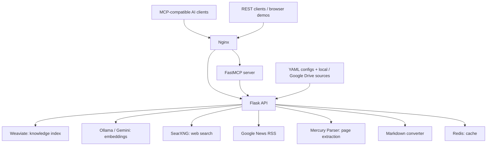

# External Knowledge Base

**A self-hosted knowledge retrieval and web research platform with Docker Compose, Weaviate, Ollama, and Model Context Protocol (MCP).**

[Documentation](#documentation) · [Quick Start](#quick-start) · [MCP Integration](#mcp-integration) · [API Examples](#http-api-examples)

> **繁體中文簡介：** External Knowledge Base 是一套可自行部署的知識庫檢索與網路研究服務。透過 YAML 設定本機文件、試算表和 Google Drive 資料來源，將內容建立為可搜尋的索引，再以 HTTP API 或 MCP 提供給 AI 助理使用。系統也整合網頁搜尋、新聞搜尋與文章內容擷取功能。

## What is this project?

External Knowledge Base brings your own documents and external web information together behind a single service. Rather than uploading the same files into multiple AI applications, you can host a reusable knowledge retrieval backend and connect MCP-compatible AI clients to it.

This is a **retrieval service and tool backend**, not a complete chatbot application.

### Key features

- **Self-hosted knowledge retrieval:** Index supported local files, directories, Markdown, XLSX/ODS spreadsheets, and Google Workspace sources.
- **Hybrid and vector search:** Store indexed content in Weaviate and retrieve matching chunks or files.
- **MCP tools:** Automatically register search tools for each configured knowledge base, alongside web search, news search, and page extraction.
- **Google Drive support:** Read exportable document URLs or access private files through rclone. Native Google Docs/Sheets can be exported through the Drive API rather than read as zero-byte FUSE files.
- **Local or remote embeddings:** Use Ollama with BGE-M3 by default, or configure supported Gemini embedding models.
- **Web research:** Use SearXNG, Google News RSS, and Mercury Parser, with Redis caching where implemented.
- **HTTP API and browser demos:** Query and manage data through Bearer-authenticated endpoints and built-in demo pages.
- **Docker Compose deployment:** Run the API, MCP server, storage, search, and conversion services in containers.

## Architecture



The services are defined in [`docker-compose.yml`](docker-compose.yml). For a code-level directory map, see [Repository Structure](documents/STRUCTURE.md).

## Quick Start

### Requirements

- Docker Engine and the Docker Compose plugin
- Git
- Sufficient disk space and memory for Docker images, embedding models, and vector indexes
- Internet connectivity for the initial image and model downloads

Private Google Drive access additionally requires [rclone](https://rclone.org/) and valid Drive credentials.

### 1. Clone

```bash
git clone https://github.com/pulipulichen/docker-External-Knowledge-Base.git
cd docker-External-Knowledge-Base
```

### 2. Configure the environment

The provided `.env.example` contains INI-style section headings (for example, `[api]`). Remove those headings when creating a Docker Compose environment file:

```bash
grep -vE '^\[[^]]+\]$' .env.example > .env
```

Edit `.env` and replace placeholder secrets, especially:

- `API_KEY` — the Bearer token accepted by the HTTP API and MCP server.
- `SEARXNG_SECRET` — set a strong unique secret instead of keeping the sample value.
- `USE_MOCK_DB=false` — enables real Weaviate-backed knowledge retrieval.
- `EMBEDDING_ENGINE=ollama` and `OLLAMA_EMBEDDING_MODEL=bge-m3` — default local embedding configuration.
- `GEMINI_API_KEY` — needed only for the features/providers that use Gemini.
- `RCLONE_CONFIG_DIR` — optional host rclone configuration directory for private Google Drive export.

Do not commit `.env` or rclone credentials. Consult [.env.example](.env.example) and [Environment Variables](documents/ENV.md) for more options.

### 3. Validate and start the stack

```bash
docker compose config
docker compose up --build -d
docker compose ps
```

The first run may download the configured Ollama model and build application images. If Docker requires elevated privileges on your host, use `sudo docker compose`.

To inspect logs:

```bash
docker compose logs -f
docker compose logs -f api
docker compose logs -f mcp_server
```

### 4. Open the demo pages

With the default port mappings, the following URLs are available on the Docker host:

- [Knowledge base retrieval](http://localhost:8080/demo/retrieval)
- [Web search](http://localhost:8080/demo/search)
- [Web page scraping](http://localhost:8080/demo/scrape)
- [News search](http://localhost:8080/demo/news)
- [Knowledge base reset](http://localhost:8080/demo/reset)
- [SearXNG interface](http://localhost:40002)
- [Weaviate UI](http://localhost:47777)

The demo pages accept the configured `API_KEY` for authenticated API calls. The reset page can delete indexed data: use it with care.

See [Demo Pages](documents/DEMO.md) for usage details.

## Configure a Knowledge Base

Each YAML file in `knowledge_base/configs/` defines a knowledge base. Its filename (without `.yml` or `.yaml`) becomes the `knowledge_id`.

For example, `knowledge_base/configs/inventory.yml` can index a spreadsheet named `knowledge_base/files/inventory.xlsx`:

```yaml
path: inventory.xlsx
description: Search inventory items and where they are stored.
section: Inventory

include_fileds:
  - Item
  - Location
  - Description

index_fields:
  - Item
  - Description

display_fields:
  - Item
  - Location
  - Description

auto_update:
  delay_seconds: 1800
```

- `section` selects the worksheet used by default.
- `include_fileds` chooses columns to keep when converting spreadsheet rows. **The spelling is intentional**: it is the legacy key recognized by the current code.
- `index_fields` selects columns contributing to searchable text and embeddings.
- `display_fields` selects columns returned by default.
- `auto_update.delay_seconds` controls refresh throttling. The current implementation does **not** use `auto_update.enable` as an independent on/off switch.

Other examples are available under [knowledge_base/configs](knowledge_base/configs). For directories, document URLs, spreadsheet sheet names (`knowledge_id!SheetName`), and indexing options, see [Knowledge Base Configuration](documents/CONFIG.md).

### Index configured sources

To queue indexing of all known YAML configurations:

```bash
curl -X POST http://localhost:8080/ingest/all \
  -H "Authorization: Bearer YOUR_API_KEY" \
  -H "Content-Type: application/json" \
  -d '{"force_update": true}'
```

The API responds with `202 Accepted` once processing is queued; indexing itself continues asynchronously. You can also use **Index all configs** on the retrieval demo page.

## MCP Integration

The default Streamable HTTP endpoint is:

```text
http://localhost:8080/mcp
```

MCP requests require a Bearer token matching `API_KEY` (provided to the MCP service as `MCP_API_KEY`). Use an MCP client capable of Streamable HTTP with Bearer authentication, or a compatible secure proxy/tunnel.

### General tools

- **`search_web`** — search using SearXNG. The underlying search API supports full-text article enrichment.
- **`search_news`** — search Google News RSS, optionally retrieving article text.
- **`scrape_web_page`** — extract readable content from a supported page URL.

### Dynamically registered knowledge tools

For each YAML configuration found when the MCP server starts, it registers:

- **`search_<knowledge_id>_chunks`** — find matching content chunks.
- **`search_<knowledge_id>_files`** — request file-level retrieval.

For `inventory.yml`, these become `search_inventory_chunks` and `search_inventory_files`.

Tool arguments include the query, `top_k`, `score_threshold`, `disable_metadata`, and optional `display_fields`. The YAML `description` is reused as the MCP tool description, so meaningful descriptions help AI clients choose the right source.

**Adding or removing YAML files?** Restart the MCP server to refresh its tool registrations:

```bash
docker compose restart mcp_server
```

See [API Documentation](documents/API.md) for additional retrieval and tool behavior.

## Google Drive and rclone

Private Google Drive sources can use `rclone_source` instead of a public document URL:

```yaml
path: inventory.xlsx
rclone_source: "gdrive:Documents/inventory.xlsx"
description: Search a private Google Drive spreadsheet.
section: Inventory
```

The API image includes rclone. Its container needs access to your host rclone configuration through the Compose mount controlled by `RCLONE_CONFIG_DIR` (default: `/root/.config/rclone`).

### Optional rclone mount

For a regular Google Drive directory mounted under the repository's data folder:

```bash
mkdir -p ./knowledge_base/files/.mnt/gdrive
rclone mount gdrive:/documents \
  ./knowledge_base/files/.mnt/gdrive \
  --daemon \
  --vfs-cache-mode full \
  --vfs-cache-max-age 24h \
  --drive-export-formats "docx,xlsx,pdf" \
  --vfs-read-chunk-size 32M \
  --vfs-read-chunk-size-limit 2G \
  --vfs-read-wait 180s \
  --disable-http2
```

The mount command assumes your rclone remote is called `gdrive` and that FUSE mounting is available on your host. For private native Google Sheets/Docs, use `rclone_source` or the documented export mechanism: these files may appear as zero bytes through FUSE.

**Storage note:** rclone mounts do not replace local cache, Docker volumes, Weaviate indexes, or downloaded embedding model storage.

Read the [rclone Mount Guide](documents/rclone/3.mount.md) for the detailed export workflow.

## HTTP API Examples

All major endpoints use `Authorization: Bearer YOUR_API_KEY`.

### Retrieve knowledge

```bash
curl -X POST http://localhost:8080/retrieval \
  -H "Authorization: Bearer YOUR_API_KEY" \
  -H "Content-Type: application/json" \
  -d '{
    "knowledge_id": "example",
    "query": "webcam",
    "retrieval_setting": {
      "top_k": 5,
      "score_threshold": 0.1
    }
  }'
```

### Search the web

```bash
curl -X POST http://localhost:8080/search \
  -H "Authorization: Bearer YOUR_API_KEY" \
  -H "Content-Type: application/json" \
  -d '{"query": "open source knowledge management", "fulltext": false}'
```

### Extract a webpage

```bash
curl -X POST http://localhost:8080/scrape \
  -H "Authorization: Bearer YOUR_API_KEY" \
  -H "Content-Type: application/json" \
  -d '{"url": "https://example.com/article"}'
```

Other endpoints include `POST /news`, `POST /ingest/all`, and `POST /reset`. Full request/response schemas and reset warnings are in [API Documentation](documents/API.md).

## MCP Integration Tests

Docker-based tests run within the `mcp-test` Compose profile; MCP Python packages are not required on the host.

From the repository root:

```bash
./test/run-mcp-test-docker-search-web.sh
./test/run-mcp-test-docker-search-news.sh
./test/run-mcp-test-docker-scrape-web-page.sh
./test/run-mcp-test-docker-search-knowledge-base.sh
```

These scripts use `sudo docker compose` and need `API_KEY` configured in `.env`. The shared runner lives in [test/mcp-test-docker-common.sh](test/mcp-test-docker-common.sh).

The default knowledge test uses `knowledge_id=example`. To change the tested knowledge base or query, configure `MCP_TEST_KB_ID` / `MCP_TEST_KB_QUERY` as documented by the scripts.

**Caution:** The tests use `--abort-on-container-exit`, which can stop services started during that Compose invocation. Avoid launching them indiscriminately against a production deployment.

## Maintenance and Troubleshooting

- **Check containers:** `docker compose ps`.
- **Check logs:** `docker compose logs -f api` or `docker compose logs -f mcp_server`.
- **Refresh MCP tools:** `docker compose restart mcp_server` after changing the YAML configuration list.
- **Validate Compose:** `docker compose config` before starting.
- **Google Sheets errors:** Check `rclone_source`, Drive permissions, rclone config mounting, and whether API export is needed for native Google documents.
- **Empty retrieval:** Confirm the YAML exists, ingestion has completed, `USE_MOCK_DB=false`, and Weaviate/embedding services are working.
- **Search or scrape errors:** Inspect API, SearXNG, and Mercury Parser logs. External sites may block content extraction.

The repository also includes [`startup.sh`](startup.sh), which stops the stack, pulls Git changes, rebuilds/recreates containers, and prints `SUCCESSFUL` after its shell steps succeed. This message is **not** an end-to-end readiness or indexing check. Because the script stops running services, review it before using it on a live installation.

### Security

- Replace all sample keys and secrets before network exposure.
- Use HTTPS and network access controls for remote REST/MCP access.
- Restrict management UIs and directly published service ports. In addition to the main endpoints, the current Compose file exposes Ollama on `40001` and a direct SearXNG port on `48080`.
- Never commit `.env`, private rclone configuration, or indexed personal data.
- Back up persistent Docker volumes and knowledge base configuration/data.
- Only invoke `POST /reset` or `reset_all` when deliberate deletion is intended.

## Documentation

- [HTTP API Reference](documents/API.md)
- [Knowledge Base Configuration](documents/CONFIG.md)
- [Environment Variables](documents/ENV.md)
- [Demo Pages](documents/DEMO.md)
- [Repository Structure](documents/STRUCTURE.md)
- [rclone Guides](documents/rclone/)
- [Changelog](CHANGELOG.md)

## License

Released under the [MIT License](LICENSE). Copyright © 2025 Pulipuli Chen.

## Author and Contributions

Created and maintained by [Pulipuli Chen](https://github.com/pulipulichen).

Issues, improvements, and pull requests are welcome.
